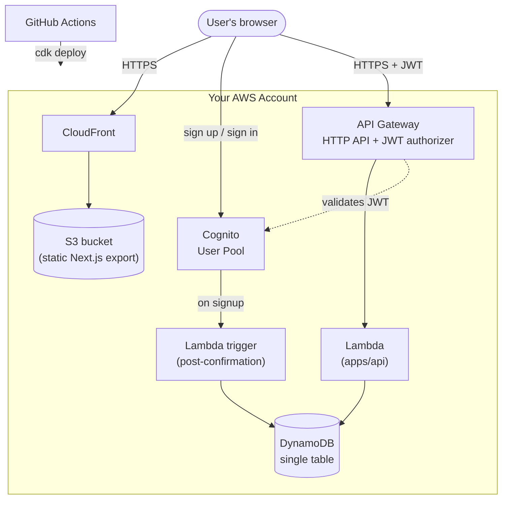

# Enterprise SaaS Starter

A production-grade, deployable SaaS skeleton for AWS. Clone it, configure your own AWS credentials, and deploy a fully working foundation — authentication, a protected API, a database, and CI/CD — in one command.

This is **not** a real SaaS product. It's an architectural reference implementation: the cleanest minimal foundation you'd want when starting a real one, so you don't have to spend a few weeks wiring up auth, roles, infra, and CI/CD from scratch.

Everything deploys into _your own_ AWS account. Nothing is hosted for you, and there's no vendor lock-in beyond AWS itself.

## Who It's For

- Indie hackers building an MVP
- Early-stage founders who need a solid, opinionated base
- Developers who want a reference for how the pieces (auth, API, infra, CI/CD) fit together in a serverless AWS stack

## What You Get

- A [Next.js](https://nextjs.org) frontend (App Router), statically exported and served from S3 via CloudFront
- [AWS Cognito](https://aws.amazon.com/cognito/) authentication, working out of the box
- A protected serverless REST API (API Gateway + Lambda)
- [DynamoDB](https://aws.amazon.com/dynamodb/) wired up with a clean data model
- Role-based access control enforced at the API level
- CI/CD via GitHub Actions
- Infrastructure as code via AWS CDK — one deploy command, no manual console setup

## Tech Stack

| Layer               | Technology                              | Why                                                                         |
| ------------------- | --------------------------------------- | --------------------------------------------------------------------------- |
| Frontend            | Next.js (App Router) + Tailwind         | Industry standard, large ecosystem                                          |
| Frontend deployment | Static export → S3 + CloudFront via CDK | Keeps everything in AWS, avoids Vercel lock-in, no server runtime to manage |
| Auth                | AWS Cognito                             | Managed, scalable, integrates cleanly with CDK                              |
| API                 | API Gateway + Lambda                    | Clean separation from frontend, fully serverless                            |
| Database            | DynamoDB                                | Serverless, scalable, fits an AWS-native stack                              |
| Infrastructure      | AWS CDK (TypeScript)                    | Infrastructure as code, single deploy command                               |
| Testing             | Jest + Playwright                       | Unit + E2E coverage                                                         |
| CI/CD               | GitHub Actions                          | Lint, test, build on every push                                             |

Dependencies are kept deliberately minimal, to keep the codebase easy to read, fork, and maintain long-term.

> **Note:** the frontend is a static export (`output: 'export'` in [apps/web/next.config.ts](apps/web/next.config.ts)), not server-rendered at request time — there's no Next.js server running anywhere. Pages that need per-request data fetch it client-side against the API. If your fork needs true SSR, that's a deliberate architecture change (e.g. adopting [OpenNext](https://opennext.js.org) to run Next.js on Lambda) — see [How to Extend This Starter](#how-to-extend-this-starter).

## Architecture



- The browser talks to two things directly: CloudFront (static frontend) and API Gateway (the API), plus Cognito for sign-in.
- API Gateway validates the caller's JWT against the Cognito user pool before Lambda ever runs — see [apps/api](apps/api/README.md#routing--auth) for how roles are then enforced per-route.
- On signup, a Cognito post-confirmation trigger provisions the user's row in DynamoDB — see [packages/infra](packages/infra/README.md#what-gets-deployed).
- Everything above is defined in [packages/infra](packages/infra/README.md) and deployed as one CDK stack.

## Project Structure

This is a pnpm monorepo:

```
apps/
  web/      Next.js frontend (App Router)
  api/      Lambda-backed REST API
packages/
  infra/    AWS CDK app — all infrastructure as code
  shared/   Types and utilities shared across apps
scripts/    Setup and deploy helper scripts
```

Each app/package has its own README with more detail:

- [apps/web](apps/web/README.md) — frontend
- [apps/api](apps/api/README.md) — API
- [packages/infra](packages/infra/README.md) — infrastructure/CDK
- [packages/shared](packages/shared/README.md) — shared types/utilities

## Getting Started

### Prerequisites

| Requirement                                                                                                                                                                             | Notes                                                                                                                                                       |
| --------------------------------------------------------------------------------------------------------------------------------------------------------------------------------------- | ----------------------------------------------------------------------------------------------------------------------------------------------------------- |
| [Node.js](https://nodejs.org) 20+                                                                                                                                                       | matches the version CI runs against ([.github/workflows/ci.yml](.github/workflows/ci.yml))                                                                  |
| [pnpm](https://pnpm.io) 10.32.1                                                                                                                                                         | version is pinned via `packageManager` in [package.json](package.json); `corepack enable` will pick it up automatically                                     |
| [AWS CLI](https://docs.aws.amazon.com/cli/latest/userguide/getting-started-install.html) v2, [configured](https://docs.aws.amazon.com/cli/latest/reference/configure/) with credentials | used by CDK to deploy; see [IAM Permissions](#iam-permissions) below                                                                                        |
| An AWS account                                                                                                                                                                          | a fresh account or a sandbox/dev account is strongly recommended — see the removal policy note in [packages/infra](packages/infra/README.md#removal-policy) |
| [GitHub CLI](https://cli.github.com) (`gh`), optional                                                                                                                                   | lets `pnpm bootstrap` set GitHub Actions repository variables for you; without it, it prints the values to set manually                                     |
| [AWS SAM CLI](https://docs.aws.amazon.com/serverless-application-model/latest/developerguide/serverless-sam-cli-install.html), optional                                                 | only needed to run the API locally against emulated API Gateway (see [apps/api](apps/api/README.md#development)) — not required to deploy                   |

### IAM Permissions

Two different sets of AWS credentials are involved, with very different scopes:

- **Your local credentials** (used by `pnpm bootstrap` and `pnpm deploy`) need broad permissions. CDK bootstrapping and stack deployment create and configure IAM roles, S3 buckets, CloudFront distributions, Cognito, DynamoDB, Lambda, and API Gateway — in practice this means an account/user with **`AdministratorAccess`**, or a policy broad enough to cover all of those services plus IAM role creation. There isn't a pared-down policy for this step; it's a one-time (or occasional) deploy-time operation, not something applications run with day to day.
- **The GitHub Actions deploy role** (created by `pnpm bootstrap`, defined in [packages/infra/src/github-oidc-stack.ts](packages/infra/src/github-oidc-stack.ts)) is scoped much more tightly: it can only assume the CDK bootstrap roles (`sts:AssumeRole` on `cdk-*`) and read stack outputs (`cloudformation:DescribeStacks`). It authenticates via [GitHub OIDC](https://docs.github.com/en/actions/deployment/security-hardening-your-deployments/about-security-hardening-with-openid-connect) — no long-lived AWS access keys are stored in GitHub at all.
- **The deployed Lambda functions** each get their own narrowly-scoped execution role from CDK (e.g. the API Lambda can read/write only the app's DynamoDB table; the post-confirmation trigger can only call `cognito-idp:AdminAddUserToGroup`) — see the relevant construct in [packages/infra/src/constructs](packages/infra/src/constructs) for exact permissions.

If you'd rather not grant admin access to your own IAM user, run `pnpm bootstrap` / `pnpm deploy` from an account created specifically for this project.

### Deployment

```bash
# 1. install dependencies
pnpm install

# 2. one-time setup — run once per repo/AWS account:
#    - cdk bootstrap's the target account/region
#    - deploys the GitHub OIDC provider + scoped deploy role
#    - sets AWS_ROLE_ARN / AWS_REGION as GitHub repo variables
pnpm bootstrap

# 3. deploy the app (infra, API, frontend) to your AWS account
pnpm deploy
```

After step 2, pushing to `main` also triggers an automatic deploy via [.github/workflows/deploy.yml](.github/workflows/deploy.yml) — `pnpm deploy` and the GitHub Actions workflow run the same underlying `cdk deploy`, so you can use either going forward. The workflow no-ops safely if `pnpm bootstrap` hasn't been run yet (it checks for `AWS_ROLE_ARN`).

`pnpm deploy` writes CDK stack outputs to `packages/infra/cdk-outputs.json` and then runs [scripts/sync-env.mjs](scripts/sync-env.mjs), which populates `apps/web/.env.local` with the deployed API URL and Cognito IDs — so a rebuild of the frontend after deploying will automatically point at the right backend.

To run the frontend against your **local** API instead of a deployed one:

```bash
pnpm dev
```

See [apps/web](apps/web/README.md#configuration) for the env vars this reads, and [apps/api](apps/api/README.md#development) for running the API locally via SAM.

## How to Extend This Starter

This repo is meant to be a starting point, not a finished product. Common next steps when adapting it:

- **Add a new API route** — add a handler in [apps/api/src/handlers](apps/api/src/handlers), register it in [apps/api/src/index.ts](apps/api/src/index.ts), and use [`requireRole`](apps/api/src/middleware/require-role.ts) if it needs RBAC. See [apps/api](apps/api/README.md#routing--auth).
- **Add a new data model** — extend the single-table design in DynamoDB: add a type + entity/GSI prefix in [packages/shared](packages/shared/README.md#whats-in-here) so the API and infra stay in sync, then read/write it from a service in [apps/api/src/services](apps/api/src/services).
- **Add a frontend page** — add a route under [apps/web/app](apps/web/app), reusing the primitives in [apps/web/components/ui](apps/web/components/ui). Remember it's a static export: fetch dynamic data client-side via [apps/web/lib/api.ts](apps/web/lib/api.ts), don't rely on server-side rendering per request.
- **Add a new role** — roles are just Cognito group names (see [`COGNITO_GROUPS`](packages/shared/src/interfaces/interfaces.types.ts) in `packages/shared`); add the group in [packages/infra/src/constructs/auth.ts](packages/infra/src/constructs/auth.ts) and extend `UserRole`.
- **Swap the static export for true SSR** — if you need per-request server rendering, the frontend construct in [packages/infra/src/constructs/frontend.ts](packages/infra/src/constructs/frontend.ts) is the piece to replace (e.g. with [OpenNext](https://opennext.js.org) on Lambda). This is a real architecture change, not a config flag — budget time for it.
- **Add infrastructure** — new AWS resources go in [packages/infra/src/constructs](packages/infra/src/constructs) as their own construct, then get wired into [packages/infra/src/saas-stack.ts](packages/infra/src/saas-stack.ts).

If you make a structural change you think other users of this starter would benefit from, consider opening a PR — see [CONTRIBUTING.md](CONTRIBUTING.md).

## License

[MIT](LICENSE)
